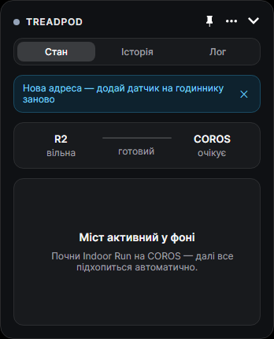
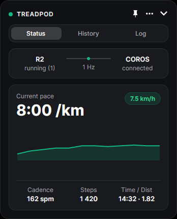
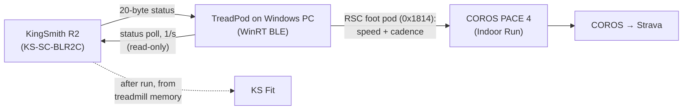

# TreadPod

**Real treadmill speed on your COROS watch — zero manual pace fiddling, zero Strava duplicates.**

Indoor runs on a watch usually force a single fixed speed you have to type in by hand. TreadPod turns the Windows PC sitting next to your **KingSmith R2** (`KS-SC-BLR2C`) into a silent Bluetooth foot pod for your **COROS PACE 4**, streaming real belt speed once a second. Because the watch itself records the workout, **COROS EvoLab**, automatic **COROS → Strava** sync, and **KS Fit** treadmill history all keep working untouched.

<table>
  <tr>
    <td align="center" width="50%">
      <br />
      <sub><b>Waiting in the tray:</b> reminds you to re-pair once after boot, vanishes automatically when COROS connects.</sub>
    </td>
    <td align="center" width="50%">
      <br />
      <sub><b>Live run:</b> pace-first HUD, speed sparkline, cadence, steps, and R2 distance.</sub>
    </td>
  </tr>
</table>

> **Status:** Windows 11 desktop app (**C# / .NET 8 + Avalonia UI** with **Velopack** installer) is built and passes 28 automated protocol, state-machine, and headless-UI tests plus a live WinRT adapter check. Real FIT-file speed and cadence were verified via the Python prototype ([treadpod.py](treadpod.py)); a full physical run on the C# desktop build is next.

---

## How it works



Your PC plays two Bluetooth Low Energy roles at the same time:

- **Read-only treadmill client:** Connects to the R2 only when needed and sends a single status-poll frame once a second. Never sends start, pause, or speed commands, so the treadmill's own session memory stays intact for KS Fit.
- **Standard RSC foot pod (`0x1814`):** Advertises continuously and pushes `0x2A53` speed + cadence notifications every second.
- **Hands-off lifecycle:** Connects to the R2 when the watch opens *Indoor Run*, rides out the watch's ~15 s pre-start sensor reconnect (30 s grace window), and releases the R2 for KS Fit either **30 s after the watch saves the run** or **after 3 min of belt idle** (requiring a full 30 s watch exit before reconnecting for the next workout).

### What you still do by hand

1. **After restarting the app or rebooting Windows:** remove the old foot pod on the watch and add the new one (see [Why Windows forces re-pairing](#the-random-ble-address-limitation)).
2. **After a run (if you want KS Fit history):** open KS Fit, resume, and stop the treadmill so the R2 flushes its stored session.

---

## Windows desktop app

Built with **C# (.NET 8)**, **Avalonia UI**, native `Windows.Devices.Bluetooth` WinRT APIs, and **Velopack**:

- **Tray-first popover:** Lives cleanly in the system tray with a color-coded status dot (gray waiting · amber scanning/idle · green running · blue released for KS Fit · red Bluetooth off), optional stay-on-top pin, and an inline confirmation warning before quitting.
- **Sleep/wake aware:** Watches Windows power resume events, restarts GATT advertising automatically, and brings back the re-pair banner.
- **History & protocol log:** Saves completed runs locally to `%LocalAppData%\TreadPod\sessions.json`, writes rolling debug logs to `%LocalAppData%\TreadPod\logs\`, and offers 1-click Copy / Logs folder buttons in the **Log** tab.
- **Clean install & uninstall:** Autostart toggle (`HKCU\Software\Microsoft\Windows\CurrentVersion\Run`) cleans up automatically when uninstalled via Velopack.
- **English / Ukrainian UI:** Built-in `EN | UK` language switch in the `···` settings menu (persisted to `%LocalAppData%\TreadPod\settings.json`).

### Download

Grab the latest Windows build from [**Releases**](https://github.com/mikhalov/TreadPod/releases/latest):

- **`TreadPod-win-Setup.exe`** *(recommended)* — 1-click Velopack installer (no UAC, Start Menu shortcut, clean uninstall).
- **`TreadPod-win-Portable.zip`** — portable archive (extract and run).

> Releases are compiled transparently from this repo via GitHub Actions. Because binaries are unsigned, Windows SmartScreen may show an *"unrecognized app"* prompt on first run — click **More info → Run anyway** (or verify `SHA256SUMS.txt`).

### Build, test, and install

```powershell
# 1. Run protocol, bridge state-machine, and Avalonia headless-UI tests (28 tests)
dotnet test TreadPod.sln

# 2. Install Velopack CLI once, then build publish/ and package releases\TreadPod-win-Setup.exe (no UAC needed)
dotnet tool install -g vpk
.\build-installer.ps1            # uses system .NET 8 Desktop Runtime (~25.8 MB)
.\build-installer.ps1 -SelfContained   # bundles .NET 8 for machines without it

# 3. Smoke-check your PC Bluetooth adapter's BLE peripheral support
.\publish\TreadPod.App.exe --check-ble
```

### First pairing on the watch

1. Install and launch `TreadPod-win-Setup.exe` (installs to `%LocalAppData%\TreadPod\current\`, adds a Start Menu shortcut).
2. On the COROS watch: **System → Accessories → Add Bluetooth** → select the PC foot pod.
3. Close/disconnect **KS Fit** on your phone (the R2 accepts one BLE client at a time), then open **Indoor Run** on the watch.

---

## The random BLE address limitation

Windows assigns a **new random Bluetooth address** to `GattServiceProvider` every time advertising starts, with no WinRT API to pin a static address ([Microsoft Q&A](https://learn.microsoft.com/en-us/answers/questions/1308165/how-to-set-a-static-device-address-for-the-ble-whe)). Because the watch bonds to the sensor's address, **leave TreadPod running via Windows autostart**. Note also that COROS PACE 4 rejects BLE SMP bonding for generic `0x1814` RSC foot pods (both passive `EncryptionRequired` and active Windows `PairAsync` fail), so bonding cannot bypass the random address rotation on restart. Unverified: whether sleep or multi-hour sessions also rotate the address.

If re-pairing ever gets annoying, here are the real ways out:

| Option | Cost | Verdict |
|---|---|---|
| **ESP32 board** running the whole bridge ([firmware/](firmware/)) | ~300 UAH *(estimate, not checked)* | **Recommended:** static BLE address, no PC needed. In progress: test pod on an ESP-WROOM-32 paired with the PACE 4, pace followed, and the watch reconnected after a board reset without re-pairing (2026-11-28) |
| Dedicated USB BLE dongle + Bumble stack | dongle | Works, but still requires the PC to stay on |
| WSL2 + `usbipd` + BlueZ | free | Needs a custom WSL kernel; fragile |

---

## Field notes: protocol quirks we hit

Real-device packet captures and COROS `.FIT` inspection surfaced several non-obvious quirks that are baked into `TreadPod.Core`:

### KingSmith R2 (`KS-SC-BLR2C`)

Unlike qdomyos-zwift's text-based `0x1234` R2 driver, this hardware revision speaks the **WalkingPad protocol** (`kingsmithr1protreadmill` in qdomyos-zwift):

| Field | Detail |
|---|---|
| GATT UUIDs | Service `FE00` · Notify `FE01` · Write `FE02` (write without response) |
| Poll frame *(only command sent)* | `f7 a2 00 00 a2 fd` |
| Status frame *(20 bytes `f8 a2 … fd`)* | `[2]` state · `[3]` speed ×10 km/h · `[5:8]` time (s) · `[8:11]` distance (×10 m, unverified) · `[11:14]` steps · `[14]` target speed ×10 (big-endian; checksum ignored) |
| Belt states | `9 8 7 6` countdown · `1` running · `3` slowing · `0` stopped · unknown states (seen: `15`) ignored; speed is forwarded only in state `1` |

### COROS PACE 4 (`0x1814` RSC)

Measurement `0x2A53` (`0x04` flags, uint16 LE speed in `1/256 m/s`, uint8 cadence) with Feature `0x2A54 = 00 00`:

1. **Cadence is treated as strides/min and wraps at 128:** Sending `~95` showed `191 spm` on the watch, and `130` wrapped to `2`. TreadPod sends `steps/min ÷ 2`, capped at `127`.
2. **Cadence `0` while running breaks speed:** When RSC cadence drops to `0` mid-run, the watch ignores the pod's speed and invents its own (`16.5 km/h` instead of `6.0`). Because the R2 step counter occasionally stalls, TreadPod holds the last non-zero cadence (or `100 spm` fallback before the first step delta).
3. **2.5 km/h pace display floor:** Below `2.5 km/h` the watch displays `—` for pace, though it still records exact speed into the `.FIT` file.
4. **~15 s pre-start drop:** Observed on every test right before workout start; absorbed by the 30 s watch grace window.

---

## Verified vs. still untested

| Check | Result | Notes |
|---|---|---|
| PC adapter (`Realtek USB VID 13D3 PID 3571`, peripheral role) | ✅ | Verified via `treadpod_test.py` and `TreadPod.App.exe --check-ble` |
| Watch speed matches treadmill in `.FIT` | ✅ | `6.0 km/h → 1.67 m/s`, `4.5 → 1.25`, `2.0 → 0.55` |
| Cadence after `÷ 2` fix | ✅ | `51 spm` in COROS (`191` before) |
| Protocol, bridge timeouts & headless Avalonia UI (`dotnet test`) | ✅ | 28/28 passing + 5 rendered UI screenshots |
| KS Fit gets session after PC read treadmill | ✅ / ❓ | ✅ after `r2_probe.py`; ❓ after a full bridge run |
| Watch reconnects after app restart | ❌ | Expected: Windows assigns a new random BLE address |

**Still to verify on physical devices:** a full 4–8 km/h run using the C# desktop app, 30 s grace + 3 min idle release on a live workout, KS Fit sync afterwards, COROS → Strava auto-sync on a bridged run, and address stability over 1+ hour or PC sleep.

---

<details>
<summary><b>Python diagnostic scripts (original working prototype)</b></summary>

Tested on Python 3.14 (`KS*` prefix match on the first KingSmith device found):

```powershell
py -m pip install bleak winrt-Windows.Devices.Bluetooth winrt-Windows.Foundation winrt-Windows.Storage.Streams winrt-Windows.Devices.Bluetooth.GenericAttributeProfile
py treadpod_test.py                              # check peripheral role & send fake 8 <-> 10 km/h
py -W ignore::DeprecationWarning treadpod.py    # Python bridge
py treadpod.py --selftest                       # cadence math check (no radio)
py r2_probe.py                                  # raw read-only R2 status log
```

</details>

## Project layout

| Path | Role |
|---|---|
| [src/TreadPod.Core](src/TreadPod.Core) | Pure C# protocol parsers (`R2Protocol`, `RscProtocol`), rolling `CadenceCalculator`, and `BridgeEngine` |
| [src/TreadPod.App](src/TreadPod.App) | Avalonia UI tray popover, WinRT BLE client/server, autostart, sleep/wake monitor, and JSON session store |
| [tests/TreadPod.Tests](tests/TreadPod.Tests) | xUnit protocol/bridge tests + `Avalonia.Headless.XUnit` click-through & screenshot tests |
| [build-installer.ps1](build-installer.ps1) | Publishes `TreadPod.App` and packs `releases\TreadPod-win-Setup.exe` via Velopack |
| [.github/workflows/release.yml](.github/workflows/release.yml) | Automated Windows release build (`Setup.exe`, `Portable.zip`, `SHA256SUMS.txt`) on `v*` tags |
| [treadpod.py](treadpod.py), [r2_probe.py](r2_probe.py), [treadpod_test.py](treadpod_test.py) | Original Python prototype & hardware diagnostic probes |

---

## Other treadmills, watches & contributing

TreadPod was built for my own setup (**KingSmith R2 `KS-SC-BLR2C` + COROS PACE 4 on Windows 11**). The Bluetooth RSC (`0x1814`) foot-pod output is standard and may work with other watches that accept BLE foot pods, while other WalkingPad/KingSmith revisions or FTMS treadmills may need small protocol adjustments.

Feel free to fork and adapt it for your own setup, or open an [Issue](https://github.com/mikhalov/TreadPod/issues) or Pull Request for your treadmill, watch, or use case (a quick BLE service dump or `r2_probe.py` output is always helpful).

---

## License

MIT — see [LICENSE](LICENSE).

Independent open-source project; not affiliated with or endorsed by KingSmith, COROS, or Strava. WalkingPad protocol interoperability notes informed by [qdomyos-zwift](https://github.com/cagnulein/qdomyos-zwift) and [ph4-walkingpad](https://github.com/ph4r05/ph4-walkingpad).
